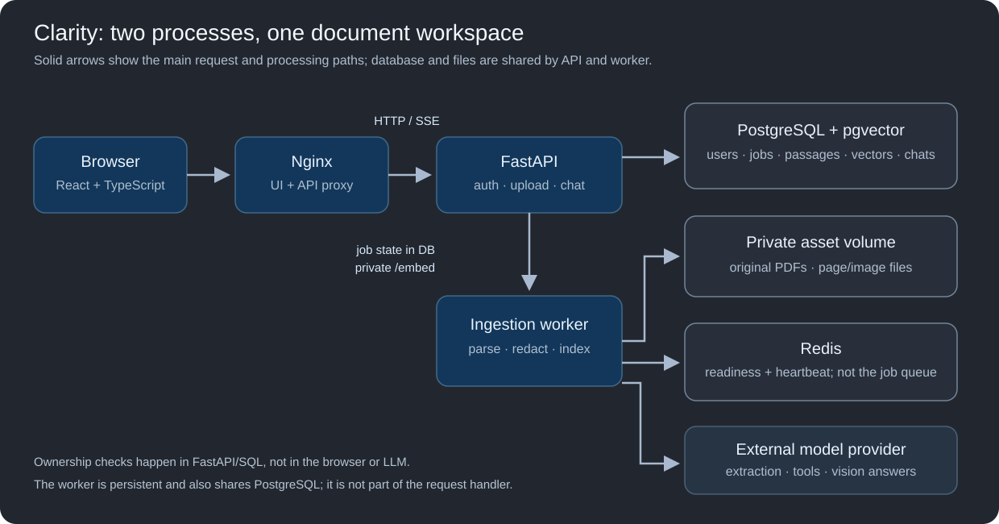
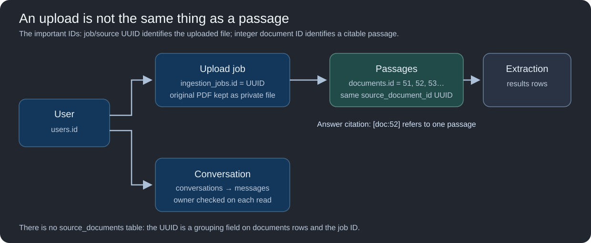
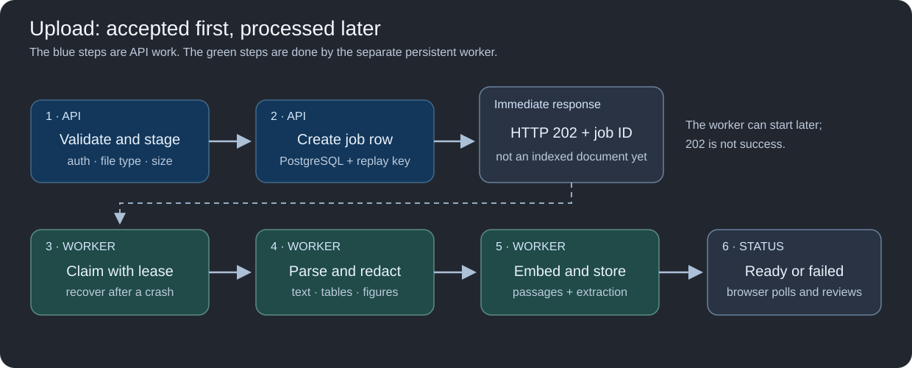
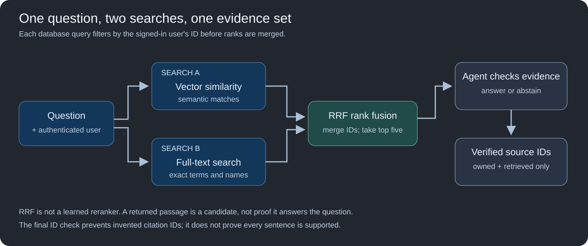
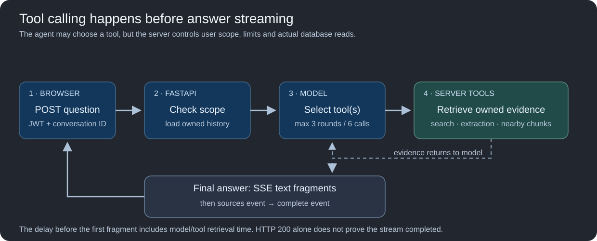
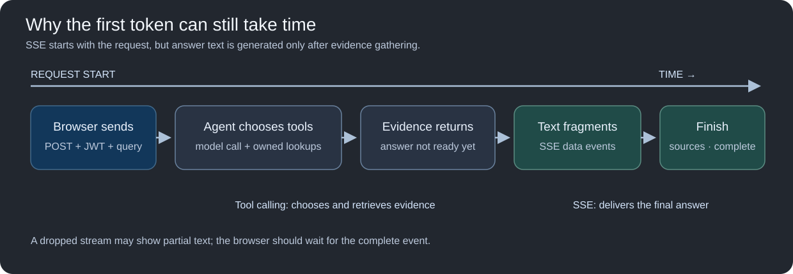

# Clarity: code-grounded interview handbook

**Purpose:** learn the actual implementation well enough to explain the product, trace a request through the code, defend the design choices, and admit limitations without freezing. This document was prepared from the source files, migrations, tests, deployment configuration, and saved evaluation artifacts in this checkout on 20 October 2026. It does **not** use the project README as a source of truth. It is a description of the repository, not a claim that every feature has been independently verified on the live EC2 deployment.

> **First rule for an interview:** describe what the code does, not what a resume bullet or an older screenshot says. “I used a small PostgreSQL-backed worker” is accurate. “I used Celery/Kafka” is not. “I used reciprocal-rank fusion” is accurate. A learned reranker is not present in this checkout.

## 1. The product in one minute

Clarity is a document-review and question-answering application for clinical-style PDFs and UTF-8 text. A signed-in user uploads a file; the API quickly validates and queues it. A separate Python worker parses pages into text, table, and image elements, redacts extracted text, creates bounded search passages, generates embeddings and structured extraction results, and stores them. The React application lets the user inspect the original PDF beside the parsed content, see extraction failures, search the account's passages, and ask follow-up questions. The agent chooses from three retrieval tools. Answers are expected to cite retrieved passage IDs, which the UI opens for inspection.

It is a **document intelligence demonstration**, not clinical decision support or a hospital-ready system. The deployed IP-based site currently uses HTTP; the original PDF and image pixels remain unredacted on the private asset volume, and visual pixels can be sent to the configured external model. Use synthetic or de-identified examples. These limits matter more than a “healthcare-grade” label.

In an interview, say: “The engineering problem was connecting document ingestion, provenance, account isolation, and evidence-backed conversational answers in one reliable workflow. The hardest parts were keeping ingestion off the API process, recovering jobs after crashes, preserving source-to-passage links, and testing where retrieval or redaction made answers fail.”

## 2. What is actually in this repository

| Layer | Implementation | Source to read |
|---|---|---|
| Browser | React + TypeScript, public home, authentication screen, library, document review, chat | `frontend/src/HomePage.tsx`, `App.tsx`, `DocumentWorkspace.tsx`, `api.ts` |
| Reverse proxy | Nginx serves the Vite build and proxies `/api/` to FastAPI | `frontend/nginx.conf`, `frontend/Dockerfile` |
| API | FastAPI routes, auth dependencies, upload and document endpoints | `app/main.py`, `app/routers/auth.py` |
| Durable work | PostgreSQL job rows, leases, retries, cleanup | `app/services/ingestion_queue.py`, `app/models/ingestion_job_model.py` |
| Worker | One claimed job at a time, heartbeat, parsing, embedding, extraction | `app/worker.py`, `app/services/ingestion_worker.py` |
| Document processing | PyMuPDF text/table/image extraction, private assets, Presidio redaction | `app/services/document_parser.py`, `document_assets.py`, `app/core/sanitize.py` |
| Search | MiniLM embeddings, pgvector cosine search, PostgreSQL full-text search, rank fusion | `app/core/embeddings.py`, `app/services/doc_search.py` |
| Agent | Tool selection, account-scoped tool execution, history, citations, SSE | `app/services/agent_service.py`, `agent_tools.py`, `conversation_service.py`, `app/providers/openai_provider.py` |
| Data | SQLAlchemy models, pgvector column, JSON extraction and job payloads | `app/models/`, `app/migrations/versions/` |
| Delivery/tests | Docker Compose, GitHub Actions, pytest, evaluation harness | `docker-compose.yml`, `.github/workflows/ci.yml`, `tests/`, `tools/run_rag_eval.py` |

There is **no separate vector database**, Celery, Kafka, OCR engine, cross-encoder reranker, Terraform, Jenkins, or AWS SDK integration in this checkout. `n8n` is an optional Compose service; exported workflow definitions are not present here, so any n8n workflow should be demonstrated separately rather than claimed as verified by this repository.

## 3. Architecture: why these processes exist



Read the request path left to right, then the worker and shared resources below it: the browser never talks directly to the database or worker. The worker is a *separate process* and PostgreSQL—not Redis—holds durable jobs. The asset volume is shared locally between API and worker. In Compose, the API gets query embeddings from the worker's private `/embed` endpoint; when that URL is unset, it can load the model itself.

The API must remain responsive while embedding/model work runs. Originally, doing processing inside the API process made a status request time out. The current design places ingestion in `python -m app.worker`. It deliberately avoids adding a broker framework: PostgreSQL is already required, and one worker on a small host is understandable and sufficient for this scale. Tradeoff: this is not a high-throughput distributed task platform; concurrent ingestion is limited, PostgreSQL also bears queue load, and operational tooling is custom.

The worker also owns the sentence-transformer model. In Docker, the API's `EMBEDDING_SERVICE_URL=http://worker:8001` makes search request embeddings through an internal endpoint rather than loading a second large model into API memory. The `/embed` endpoint checks a shared secret header and is not published to the host. Outside Docker, if the URL is unset, `embed_text()` loads the model in-process and guards inference with a lock. This saves EC2 memory at the price of an extra internal network hop and a worker dependency for search.

Redis is **not the durable ingestion queue**. It is used for dependency readiness, the worker heartbeat, and historical Redis job-status compatibility. The durable queue is `ingestion_jobs` in PostgreSQL. This distinction is a likely interview question.

## 4. How the system evolved, and the actual decisions

The Git history provides a useful chronology; it does not prove the motivation for every line, but the resulting code and tests show the changes:

1. A FastAPI extraction/search backend gained LLM tool calling and deployment/auth fixes. Early `/process` remains as a synchronous text-extraction route. It is not the preferred upload workflow.
2. The agent originally could produce an answer without retrieval. The code now requires a tool on a fresh evidence-less turn and refuses factual answers with no retrieved evidence. A Groq `tool_use_failed` response can fall back to a server-owned search call.
3. Conversation follow-ups previously failed. The agent now saves conversation/tool messages, reloads previously retrieved passage IDs from tool results, checks those IDs against the current authenticated user, and gives the model that evidence again. This is narrower than “the assistant remembers everything.”
4. Search initially missed relevant chunks under a fixed cosine cutoff. Current default search has no threshold; it takes vector and keyword candidate lists, then uses reciprocal-rank fusion. This improves candidate recall but increases the possibility of irrelevant results, so the answer model must still decide whether the passages support the question.
5. Cross-account requests and irrelevant citations led to server-side ownership enforcement plus an optional model-based intent check. The classifier affects response wording; SQL ownership checks are the true access boundary. The returned source list includes only retrieved IDs that appear in the answer, not every candidate.
6. Ingestion moved to a persistent PostgreSQL job + separate worker. Jobs have leases, retry counts, progress, checkpoints, and retention. Extraction failures now have explicit statuses instead of quietly looking successful.
7. React added a public home, login route, document library, source review, and streamed conversation UI. Nginx serves frontend/API on one origin. Updating only the API container does **not** deploy frontend changes.
8. Multimodal PDF support added distinct table and image elements, image descriptions, retained visual evidence, and PDF page/region review. This is not general image upload and is not OCR-perfect.

The through-line is one workflow: **process → review → ask → verify**. Each addition solves a failure in that workflow. That is stronger than reciting a disconnected feature list.

## 5. Data model: the names that can confuse you

The `documents` table is really a **passage table**. A single uploaded PDF can produce many `Document` rows. Every row has its own integer `id` (the citation `[doc:ID]`), redacted `raw_content`, 384-dimensional `embedding`, `chunk_index`, optional `page_number`, `element_type` (`text`, `table`, `image`), section title, visual asset references, and bounding box. Rows from one upload share `source_document_id`, a UUID also used for the ingestion job. This relationship is not a separate `source_documents` table.



This is a *relationship map*, not extra tables. In particular, `source_document_id` is a grouping column on `documents`, not a separate `source_documents` row. Parsed elements are represented by passage metadata, stored job checkpoints, and asset files; there is no `document_elements` table.

`results` is a per-passage structured extraction table: summary, category (`Adverse Event`, `Case Report`, `Lab Result`, `General`), JSONB entities, model-reported confidence, status, and error type. There can be multiple result rows for a retried passage; read endpoints choose the latest. A failed extraction does not necessarily mean the passage could not be indexed or searched.

`ingestion_jobs` holds durable lifecycle state: owner, filename, source reference/element payload, SHA-256 content digest, idempotency key and expiry, status, progress, attempts, lease owner/expiry, next-attempt time, counts, result IDs, and retention expiry.

`users` has unique username/email and a bcrypt hash. `conversations` belong to a user; `messages` contain user/assistant/tool roles, tool-call JSON and call IDs. `agent_audit_logs` record executed tool name, model-supplied arguments, success/error, and latency. There is no comprehensive distributed trace or token-cost accounting despite model fields that could hold some of it.

Older records have no `source_document_id`. `/documents` treats each as `legacy-{passage_id}`; this is why an old upload may look like several “documents” and lack an original-PDF preview. New grouped uploads look like one document with multiple passages. Do not confuse **file count** with **passage count**.

Alembic runs at API startup. The initial revision baselines existing tables rather than dropping them. Later revisions add source grouping and extraction status, durable jobs, element metadata, then bounding boxes. The first baseline is unusual: it calls SQLAlchemy `create_all`; later changes use explicit migration operations. The code has no demonstrated zero-downtime migration strategy.

## 6. Follow one upload byte-for-byte



The arrows show the order of work, not separate network services at every step. The API and worker coordinate through PostgreSQL job state and a shared asset volume.

1. The browser sends a multipart `POST /api/upload` with a randomly generated `Idempotency-Key` header. The key is reused for a client retry of the same selected file and removed after acceptance. The API route requires a bearer token; `get_current_user` decodes its JWT and loads the user.
2. FastAPI reads at most `20,000,001` bytes. More than 20,000,000 bytes yields 413. `validate_document_upload` accepts UTF-8 `.txt` or PDF; it strips empty text and checks the PDF `%PDF-` signature. It does **not** fully parse the PDF in the API process. The filename is reduced to a basename and sanitized.
3. The API writes the raw upload to the private shared asset volume at an owner/UUID path. It inserts a PostgreSQL job whose JSON payload points to that staged file, then responds **202 Accepted** with `job_id` and `document_id` (both the upload UUID). 202 means queued, **not** parsed, extracted, or searchable yet.
4. The worker polls PostgreSQL, claims an eligible row with `FOR UPDATE SKIP LOCKED`, marks it processing, assigns a lease owner/90-second expiry, increments attempts, and starts a heartbeat thread that extends the lease every 10 seconds. The worker runs one claimed ingestion job at a time.
5. It reads the staged source and runs PyMuPDF parsing in a thread. For new PDFs, it privately copies the original to `user_id/source_document_id/source.pdf` so the reviewer can render/download it. The original remains **unredacted**. The staged upload is removed only after a durable parsed-elements checkpoint is saved, allowing safe retry after a crash at that boundary.
6. Parsed text and nearby visual context are run through Presidio before persistence and provider calls. Extracted images are saved as private files; JSON job state stores asset references, not image byte arrays.
7. The worker creates passages. Text is recursively split at **500 characters with 50-character overlap**. Tables and figures are kept as distinct citable elements; text/table elements may be split. Each passage preserves page and order.
8. A figure gets a model-generated caption, which is embedded for text-based retrieval. A caption failure creates a safe placeholder plus `ImageDescriptionFailed`, and the worker can retry that caption. Original pixels remain available as visual evidence if that figure is retrieved.
9. Each passage is embedded with `all-MiniLM-L6-v2` (384 values) and sent to the text LLM for structured extraction. Pydantic validates required keys, one of four categories, and confidence in `[0,1]`. Success or an explicit fallback/error result is committed with the passage. Completed passages act as restart checkpoints.
10. At the end the job becomes `completed` when all passage extractions succeed, or `completed_with_errors` when one or more fail. `extraction_status` is `succeeded`, `partial`, or `failed`. The UI polls `/jobs/{id}` every 2.5 seconds, then refreshes the document list.

**Idempotency is not universal deduplication.** It applies to a caller-supplied key per user. The server stores a SHA-256 digest; repeating the same key with different content returns 409. A different key can create another upload of the same file. Key ownership and 24-hour expiry matter. Concurrent same-key submissions are resolved by the unique database constraint, not just an in-memory map.

## 7. Parsing, tables, figures, and larger PDFs

`document_parser.py` uses PyMuPDF (`fitz`) to walk PDF pages. It calls `page.get_text('dict')` for positioned text blocks; `page.find_tables()` for table rectangles and extracted cell rows; and `page.get_images(full=True)` for embedded raster objects. The table is serialized into Markdown with header/separator/body rows. Text blocks substantially overlapping a detected table are omitted from the separate text list to avoid indexing the same cells twice. Elements are sorted by vertical page position. The parser attaches a nearby section heading where it can identify one from larger preceding text spans.

For each retained image, it stores image bytes, MIME type, page, section, nearby text, and a bounding box from the PDF when available. A page with many vector drawings can be rendered as a PNG to capture charts that have no embedded image object. Limits are: 100 PDF pages, at most 30 visuals per PDF, at most 3,000,000 bytes per visual, and minimum image dimensions/area. A 20 MB PDF can still be expensive because page parsing, figure captioning, embedding, and LLM extraction happen per element; the limits bound obvious cases but are not a performance guarantee.

**What “multimodal” means here:** the file must be PDF, not standalone JPG/PNG. Text and tables become textual passages; figures receive text descriptions to make them searchable; when retrieved, up to three original image assets may be sent to the vision model for the final answer. The current implementation does not have a dedicated OCR engine, a table-cell citation model, or guaranteed exact transcription of scanned tables. A scanned PDF with one full-page image may be accepted and captioned, but its numeric extraction can be unreliable. This is precisely why scanned and tabular tests are useful.

The source-review UI retrieves an authenticated rendered page from `/documents/{uuid}/pages/{n}/preview` and overlays parsed bounding boxes as clickable regions. It shows parsed content, model extraction, and indexed passages separately. A source citation opens the exact stored passage and any attached visual. This is more honest than just displaying an answer with a filename.

## 8. Redaction and its tradeoff

`sanitize.py` uses Presidio with spaCy `en_core_web_sm`, plus recognizers for MRN, subject ID, and patient ID. It targets person names, phone numbers, email, SSN, locations, IPs, and those custom IDs. Date regexes replace selected date formats with `<DATE>`. There is a narrow exception for a camel-case name immediately following a medication/treatment phrase, added because medication names were being replaced with `<PERSON>`.

This is **lossy**: a legitimate calendar date or name may be unavailable in an answer, and the rule may not generalize to every medication name. Model-generated image descriptions are sanitized after the external image call, and the image-call prompt instructs the model not to repeat identifiers. The **raw image pixels are still transmitted to the configured external vision model**. Original PDFs and pixels are retained privately for review and are deleted with the uploaded document, not automatically de-identified. A confident interview explanation is: “I added automated redaction to reduce exposure and measured its effect on answer quality. It is not a guarantee of privacy or regulatory compliance.”

The provider client uses the OpenAI-compatible SDK with Groq's base URL. The text model is `openai/gpt-oss-20b`; the vision model is configurable (default in code: `qwen/qwen3.8-27b`). Retries with exponential backoff cover selected rate-limit/API exceptions. Do not claim all failure classes are retried or that external provider calls have been subjected to clinical privacy review.

## 9. Worker recovery: explain the failure timeline

The job state machine is approximately:

```text
queued → processing → completed
                    → completed_with_errors (passages exist; extraction(s) failed)
                    → retrying → processing (transient job-level failure)
                    → failed (permanent validation failure or attempt cap)
completed/completed_with_errors/failed → deleted status when user deletes document
```

The queue code tries at most **three claims**. When processing fails, `retry()` records only the error type, schedules the next attempt after `5 × attempt_number` seconds, and either marks retrying or failed. A `ValueError` or 4xx HTTP exception is considered permanent. If a worker crashes without calling `retry()`, its lease eventually expires and another claim can recover it. A heartbeat extends the lease while the process is alive. Before a chunk commit, `queue.lock_owned()` checks that the current worker still has an unexpired lease; this **fences** a stale worker that woke up after another worker reclaimed the job. The key database primitive is `SELECT ... FOR UPDATE SKIP LOCKED`, which prevents two workers from claiming the same row at the same moment.

The subtle part: persisting the parsed elements and committing each passage/result are checkpoints. On recovery, the worker detects an existing passage by `(source_document_id, user_id, chunk_index)` and reuses a completed result rather than repeating provider calls. Image caption failures are an exception: if the job is recovered, that passage is eligible for re-description. A `completed_with_errors` job is terminal; there is **no automatic background requeue of just the failed extraction after terminal completion**. The UI reports the failure and the user can upload again. These are **at-least-once processing semantics with checkpoint-based duplicate protection**, not a mathematically exactly-once pipeline.

Retention is separate from document retention: terminal job rows expire after about 30 days; idempotency keys are cleared after 24 hours. Stale orphan `.upload` files are swept after a minimum age. Original PDFs and visual assets persist until the document is deleted. Conversation history has no user-facing deletion lifecycle in the present API. The worker's cleanup runs periodically, not transactionally with every job.

**Whiteboard explanation of a crash:** “Suppose the worker commits passage 1 then dies on passage 2. The job row stays `processing` but its 90-second lease stops renewing. After lease expiry, another claim increments attempts. The worker reads its persisted parsed elements, finds passage 1 and its result, skips redoing it, then resumes at passage 2. If the old worker wakes up and tries to commit, ownership fencing rejects it.”

## 10. Embeddings and retrieval, exactly



`all-MiniLM-L6-v2` maps a query or passage to a 384-dimensional vector. The `documents.embedding` column is `pgvector Vector(384)`. Conceptually, semantic retrieval orders owner-scoped passage vectors by cosine distance: smaller distance means closer direction in embedding space. This helps match paraphrases, but short medical phrases, dates, numbers, and names can be difficult. The model is general-purpose, not clinically fine-tuned.

`generate_relevant_docs(query, limit, user_id, db)` clamps the requested limit to 1–10. Default `/search` passes 5. It embeds the query; fetches the top **20** vector candidates by cosine distance (or more if the requested limit were larger); separately builds a PostgreSQL English `tsvector` from a normalized filename plus passage text and ranks matching rows using `ts_rank_cd`. Both queries include `Document.user_id == authenticated_user_id`. There is no evidence in migrations of an HNSW/IVFFlat vector index or a materialized GIN full-text index; rankings appear to be calculated at query time. This is acceptable for a small corpus but not a demonstrated large-scale search design.

The two candidate lists are fused with **reciprocal-rank fusion** (RRF):

```text
RRF(document) = Σ over rankings [ 1 / (60 + rank_in_that_ranking) ]
```

A passage appearing near the top of both lists gets contributions from both. RRF avoids pretending a cosine distance and a full-text rank have comparable units. It deduplicates by passage ID, sorts fused scores, and returns five. This is **rank fusion**, not a neural/LLM reranker and not maximal marginal relevance (MMR). The optional explicit cosine threshold path is for experiments; the default uses no cutoff because the old fixed cutoff discarded genuine evidence. Tradeoff: recall improves, precision can suffer. Therefore returned passages are **candidates**, not proof that the answer is present. The answer step must still abstain when evidence is insufficient.

For image chunks, the embedding is computed from a generated description. A weak caption can make the right figure unfindable, even though its pixels are retained. This is a retrieval bottleneck of the multimodal path. An image answer only sees visual assets if the corresponding image passage made it into the retrieved source list.

## 11. The agent protocol: every turn, not just “LLM calls a tool”



This is one *request path*. Tool calling chooses how to fetch evidence; the server enforces authorization. Citation-ID validation stops fabricated IDs from being returned as sources but cannot prove that the prose is factually supported.

The API has two chat routes: `POST /chat/agent` returns one JSON object; `POST /chat/stream` emits SSE. Both use the same main orchestration concepts. A chat request carries `query` and optional `conversation_id`. If no ID is supplied, a new conversation is created. If an ID is supplied but does not belong to the authenticated user, the server returns 404 rather than silently starting another chat. The query is sanitized, saved as a user message, and recent conversation history is loaded by **whole user turns** so that assistant tool calls are not separated from their tool results.

An optional model classifier looks at recent user messages and detects requests specifically for another account's records/chats. If it flags such a request, the agent returns a fixed refusal **without search**. If the classifier fails, the system logs a warning and continues under server-enforced account scope. That is deliberate: a probabilistic classifier must not be the security boundary. Mixed own-record/cross-account requests rely on the normal agent instructions to answer the allowed part and refuse the restricted part.

Three model-visible tools are declared in `app/providers/tools.py`:

1. `search_medical_records(query)`: hybrid search for the authenticated account. The model supplies only search text. The server injects `user_id`, database session, and limit 5; model-supplied owner or limit fields are ignored.
2. `get_extraction_result(document_id)`: fetch the latest stored summary/category/entities/confidence/status for an owned passage already found in search. A failed extraction must not be presented as a fact.
3. `get_related_document_chunks(document_id)`: fetch up to two preceding and two following passages from the same upload when an answer spans a chunk boundary. Legacy records use a filename-stem fallback.

The registry dispatches only recognized names. Tool arguments are parsed as JSON; malformed search arguments fall back to the user's original question. The code caps execution at **three rounds and six calls**. It saves assistant tool-call messages, tool results, and final assistant messages, and writes tool audits with latency and success/error. If a tool fails and nothing has been retrieved, the response says search failed and asks for retry—not “there is no answer in your records.”

On a new conversation with no previously retrieved evidence, the first model turn is required to call a tool. When there is prior evidence, the model may answer directly or search again. The server reloads passage IDs from **previous tool-result messages**, not from assistant prose, and rechecks those IDs under the current user. This enables “Did they report chest pain?” after an earlier cardio question. It is not unrestricted memory: history is bounded, previous results may be truncated out, and if the relevant evidence was never retrieved the follow-up must search again.

After retrieval, passages are formatted with `[doc:integer_id]`, element type, section, and redacted content. If visual passages were among sources, the server can load up to three owner-checked original images and ask the vision model to generate the final answer from both text and pixels. Otherwise the text model supplies the answer. In both paths the prompt asks for each factual claim to carry `[doc:ID]`.

**What citation validation actually guarantees:** `cited_sources()` intersects IDs written in the answer with IDs from server-owned retrieved sources. It prevents an invented or unrelated ID from appearing in the response's `sources` array. It does **not** prove that each sentence is entailed by its cited passage, that every claim has a citation, or that the cited passage is the most relevant one. Manual evaluation checks semantic support. This is an excellent tradeoff to state candidly.

## 12. Streaming versus tool calling



The waiting period before the first text chunk is why streaming can feel slow even though chunks arrive incrementally afterward. The browser also needs the final `sources` and `complete` events; HTTP 200 by itself does not mean the streamed operation completed successfully.

They are orthogonal, not two competing features. **Tool calling** decides which data the agent retrieves and whether another lookup is needed. **SSE streaming** controls how the final answer reaches the browser. The flow is:

```text
client POST /chat/stream
→ server emits conversation ID
→ model/tool loop retrieves evidence (usually no answer tokens yet)
→ server streams final answer token chunks as SSE data events
→ server emits cited-source metadata
→ server emits complete event
```

In the text path, a second model call streams the final answer after tools finish. With prior evidence and no new tool call, the nonvisual answer may arrive as one data event rather than many tokens. For image evidence, the vision response has its own streaming method. The FastAPI wrapper preserves multiline SSE formatting and disables Nginx response buffering. The React client uses `fetch`, a `ReadableStream` reader, `TextDecoder`, a buffer split on blank lines, and handlers for `conversation`, `sources`, `error`, and `complete`. It can abort an active request. `EventSource` is not used because the endpoint needs a POST body and bearer header.

Streaming improves perceived responsiveness; it does **not** reduce the retrieval/tool latency before the first answer token, nor guarantee a correct answer. An interrupted stream may leave a partial answer on screen and must be treated as incomplete. Sources arrive after text, so the user may briefly see text before source chips. Also, source metadata is filtered after generation rather than used as a preflight semantic proof of every streamed claim.

## 13. Frontend flow, including login and document review

`/` is a public homepage describing process/review/ask. `/login` shows sign-in and account creation. `/app` holds the authenticated workspace, with a read-only saved sample mode. The SPA uses history state rather than a routing library. Nginx falls back to `index.html` for these paths. On login, the browser sends username/password to `/token`, stores the returned JWT in `sessionStorage`, and loads `/me`. On sign-out it clears the token. Session storage is per browser tab/session; it is not an HttpOnly cookie. Tokens expire in 30 minutes and there is no refresh-token flow.

The library fetches owner-scoped `/documents` pages, shows an upload dropzone, polls jobs every 2.5 seconds, and opens a chosen document. A document's original page preview is fetched as an authenticated blob, rendered as an image, and paired with three result tabs: parsed content, structured extraction, and indexed search passages. Bounding boxes are expressed in PDF page coordinates and converted to image-relative CSS percentages. Clicking a highlighted region scrolls to its parsed passage. An earlier legacy passage without retained original cannot show the full PDF preview.

The chat view keeps conversation IDs, opens saved conversation history, sends the query to `/chat/stream`, appends streamed text, and displays source chips. Clicking a source loads `/chunks/{id}` and any visual blob. The source panel is the user's verification point. The sample workspace is saved frontend fixture data, not an unauthenticated route into a real user's records.

The frontend retries an upload with the same idempotency key while that file remains in its local retry map; it does **not** persist that map across refreshes. Job IDs are stored in session storage so the page can resume polling after a reload. The browser validates file extension/size for UX; the API repeats validation because client-side validation is never a security boundary.

## 14. Authentication, ownership, and privacy boundaries

Registration validates username length 3–50, a valid email, and password length at least 12. The password is hashed with bcrypt. `/token` accepts the OAuth2 password form and signs an HS256 JWT containing a numeric user ID subject and expiry. `get_current_user` verifies signature/expiry and loads the user. A server restart with a different `SECRET_KEY`, a different database/user table, or an expired token can make previously issued tokens unusable. Existing users are in whichever database `DATABASE_URL` points to; switching to a new local Compose database instead of the intended Neon database would explain “my old users disappeared.”

Ownership is enforced in SQL for passages, jobs, conversations, original PDF access, page previews, and visual assets. The tool implementation never accepts a tenant ID from the model. File asset paths are resolved under the authenticated user's directory to avoid path traversal. The cross-account intent classifier produces an early refusal but can be wrong; SQL-scoped reads are the real defense. Tests cover owner-only job/status/source access, tool-scope override attempts, unowned conversation IDs, and asset path escape.

Important limitations to say aloud: there is no database Row-Level Security policy in this checkout, no HTTPS termination in the shown IP deployment, no security certification or HIPAA compliance claim, no human review workflow for redaction, and no guarantee that unredacted visual pixels are safe to send to an external provider. The code writes model-supplied tool inputs to audit logs, which are useful diagnostically but themselves require privacy-aware retention and access control.

## 15. Deployment and operations: what is real

`docker-compose.yml` defines a pgvector/PostgreSQL container, API, worker, frontend/Nginx, Redis, and optional n8n profile. The API and worker share a named asset volume and Hugging Face cache. The API image installs CPU PyTorch, Python requirements, and spaCy's small English model. The frontend uses a Node build stage and a separate Nginx runtime stage. Nginx serves static files, proxies `/api/` and legacy direct API paths, forwards SSE without buffering, and serves public sample PDFs. The environment-selected `DATABASE_URL` determines which PostgreSQL instance is actually used; starting the local database container does not prove the API is connected to it.

`/health/live` only says the API process is running. `/health/ready` checks database connectivity and Redis ping. The worker's Compose health check reads a Redis heartbeat (`worker:heartbeat`) set with a 60-second TTL. These are useful but not a comprehensive external monitoring or alerting system. Logs are mostly Python logging plus Docker container logs; there is no verified Prometheus/OpenTelemetry stack in the repo.

GitHub Actions runs a frontend TypeScript/Vite build and Python pytest on pushes/PRs to `main`. It does **not** deploy automatically to EC2, run Terraform, or perform production smoke tests. The current `frontend/nginx.conf` has `client_max_body_size 6m`, while API/UI validation advertises 20 MB. Therefore a file between about 6 MB and 20 MB can be rejected by Nginx before FastAPI sees it. That is a concrete configuration defect to acknowledge and fix before claiming a working 20 MB end-to-end limit.

Deployment pitfall learned in this project: `docker compose up -d --build api` only rebuilds/recreates the API. A browser can keep seeing the old frontend until `frontend` is rebuilt/recreated. If API and worker code changed, both images/processes must be aligned. Do not casually run `git reset --hard` on EC2: it destroys uncommitted tracked changes; inspect `git status` and preserve unexpected files first.

The optional n8n service is provisioned in Compose, but the repository does not contain a workflow export or tests for it. If you discuss an n8n integration, show the actual workflow separately and explain triggers, auth, retries, and failure alerts. Do not make it a core verified claim from this source tree alone.

## 16. Evaluation: exact saved evidence and how to defend it

The checked-in `eval/summary.json` is a historical run over **40 questions**, not a 100-question held-out benchmark. `eval/results.csv` has 80 endpoint rows: 40 `/search` and 40 `/chat/agent`. The current `eval/corpus.json` has **41** question entries; its additional multimodal question is not reflected in that saved 40-question summary. Do not combine current corpus size with old results or call the 40 questions “100 held-out.” The saved questions are a small synthetic/demo corpus, not clinical validation.

| Saved measure | Exact result | Meaning and limitation |
| --- | --- | --- |
| Fully correct answer/refusal decisions | 36/40 = 90% | Manual `answer_correct=yes` grades; 4 partial, 0 `no` |
| Retrieval hit@5 | 25/29 = 86.21% | On answerable questions, normalized expected `evidence_quote` appears in concatenated top-five `/search` passage text |
| Search HTTP successes | 40/40 | Responses succeeded; not proof of relevance |
| Agent HTTP successes | 40/40 | Responses succeeded; not proof of correctness |
| Search median / p95 | 1,735.5 / 1,920.3 ms | From successful `/search` calls in that run |
| Agent median / p95 | 9,786.0 / 16,789.8 ms | End-to-end agent requests; do not compare directly to cached URL redirects |
| Citation manual grades | 29 yes, 1 partial, 0 no, 10 ungraded | **Not** 100% independently verified factual claims |
| Privacy-safe grades | 3 yes / 3 graded | Very small scripted set; not a complete security audit |

The runner in `tools/run_rag_eval.py` uses authenticated HTTP calls, measures each endpoint, stores responses and IDs in CSV, preserves existing human grades when rerun, and computes the summary. Its percentile function sorts the values and linearly interpolates between adjacent ranks. The recall check normalizes case and punctuation, then searches for the expected quote in the joined top-five returned passage text. This is a convenient retrieval probe, but it can miss paraphrases, accept a quote in a wrong context, and is sensitive to the expected quote chosen. The runner also has newer expected-source recall/MRR and multimodal fields, but those are **not present in the saved summary**; do not assign them retrospective numbers.

Four partials deserve an honest explanation. Q04 returned redaction placeholders as medication/dose instead of clearly saying the details were unavailable. Q09 gave 25 mg but omitted the medication name. Q12 omitted a redacted calendar date. Q26 omitted a redacted discontinuation date. These are redaction/answering interactions, not evidence that the pipeline never saw the PDF. The right improvement is to make unavailability explicit and evaluate entity-preservation/redaction separately, not to hallucinate a plausible value.

The corpus and grading methodology matter as much as the percentage. The harness is sequential; it is not a concurrent load test. The labels for answer correctness, refusal, citation support, and privacy are manual and can be subjective; the script does not judge them with an LLM. There is no demonstrated independent clinical expert review, multi-annotator agreement, 100-question result, robust out-of-domain document suite, or prospective production quality monitoring in this checkout. For a stronger next evaluation, freeze separate development and held-out corpora; add scanned, table-heavy, figure-heavy, long, irrelevant, adversarial, and cross-tenant cases; verify page/region citation support claim by claim; capture first-token latency, token usage/cost, and error taxonomy; and rerun after every parser/retrieval change.

## 17. Tests and what they actually establish

On this checkout, `python -m pytest -q` completed with **67 passed, 1 warning**. The warning was pytest's inability to write its cache under current filesystem permissions; it was not a failing test. Tests cover validation, document parser/element extraction, source assets, ingestion queue and worker behavior, search, agent/conversation behavior, privacy and ownership boundaries, provider fallback, frontend/API contracts, and evaluation utilities. Their exact mocks and fixtures matter: a passing unit test does not prove the external provider, EC2 Nginx, Neon database, browser, or n8n is functioning in production today.

There are also diagnostic scripts under `tools/`: `verify_access_policy.py`, `verify_retrieval_flow.py`, `smoke_worker_recovery.py`, `smoke_ui_flow.py`, and `diagnose_retrieval.py`. Treat their presence as available verification workflows, not proof they all ran against the current live deployment. CI invokes the frontend build and pytest. It does not run an authenticated live browser test or promote a release.

| Failure injection / check | What should be demonstrated | Where to inspect |
| --- | --- | --- |
| Same upload key retried | Existing job returned, not a second independent job | Upload handler, unique constraints, `tests/test_ingestion_queue.py` |
| Worker killed mid-job | Recoverable lease/job returns to work without corrupting state | Queue claim/recovery code and worker smoke script |
| External model temporarily fails | Bounded retries / recorded failure, no infinite loop | Provider wrapper and ingestion job state |
| Two user accounts | User B cannot fetch A's document, source, job, conversation, or visual asset | Auth dependencies, SQL filters, privacy/API tests |
| Model tries `user_id` override | Tool ignores/disallows model-chosen account scope | Agent tool registry and tests |
| No relevant passage | Insufficient-evidence answer, not a fabricated citation | Agent service and evaluation cases |
| Tool or provider fails during stream | Browser receives error event/partial-state handling | Stream endpoint and React stream parser |
| PDF 10 MB via Nginx | Currently likely rejected upstream at 6 MB | Nginx config versus API/UI 20 MB limit |
| Scanned image-only PDF | Current parser cannot promise OCR | Parser rejection/limitations and multimodal tests |

The table is a study/test checklist, not a claim that every item passed in a deployed environment. In an interview, distinguish automated unit/integration tests from a manually observed EC2 end-to-end run.

## 18. Failure diagnosis map

| Symptom | First checks | Likely interpretation / next action |
| --- | --- | --- |
| Upload returned 202 but no answer | Poll that job; inspect worker heartbeat and job error; inspect owner-scoped documents | 202 means accepted, not indexed. Check whether parsing/embedding completed. |
| `/search` returns `[]` | Confirm the same account, job terminal state, saved passages, embedding configuration, query terms | No matching indexed passage, wrong account, incomplete job, or retrieval mismatch; do not conclude source document is absent from an upload banner alone. |
| Agent says insufficient evidence despite chunks | Compare raw `/search` hits with agent tool calls/audit log and source filters | Tool selection or evidence gating may be the problem; prompts alone are not proof. |
| Wrong document cited | Compare answer's `[doc:id]` tags, returned source IDs, and actual passage contents | ID filtering only validates membership, not semantic entailment. |
| Frontend looks unchanged after backend deploy | Identify which service was rebuilt; inspect frontend image/browser cache | Rebuild/recreate `frontend`, not only `api`; do not erase uncommitted EC2 files. |
| Previously valid login fails after restart | Check JWT expiry, `SECRET_KEY`, `DATABASE_URL`, user row, browser token | The app has no refresh tokens; changed key/database invalidates expected login behavior. |
| Upload fails near 6 MB with 413 | Inspect Nginx and API size limits | Nginx 6m currently precedes API's 20 MB limit. |
| Job seems stuck after worker restart | Worker service health, DB lease/status/attempts, shared asset path | Distinguish queued, running, recoverable, terminal failed. Redis heartbeat alone does not mean a specific job progressed. |
| Page preview missing for old row | Check whether it has a `source_document_id` and stored original | Legacy passage rows cannot recreate an original PDF that was never saved. |
| SSE shows HTTP 200 then error/partial text | Inspect SSE `error`/`complete` events and provider/tool logs | Headers were already sent; response status is not the full outcome. |
| Figure answer lacks visual details | Inspect element detection, crop storage, caption, model configuration | Extracting nearby text is not the same as OCR or giving model the original pixels. |

Do not troubleshoot with broad SQL queries across accounts in production just because a local diagnostic is convenient. Use a test account, bounded logs, and owner-scoped queries.

## 19. Interview questions: answer, evidence, and honest boundary

Practice these aloud without reading the answer. Then open the cited source file and trace one concrete request. If asked a variation you cannot prove, say what you would inspect or measure.

**1. What does Clarity solve?** It combines an asynchronous document-ingestion workflow with a reviewable, account-scoped evidence-search/chat workflow. The value is not merely that an LLM can answer questions: users can inspect what was extracted and click the passages that informed an answer. Point to the library, document workspace, and agent endpoints. Boundary: it is not medical decision support.

**2. Why not do PDF processing in the upload request?** Parsing, local embedding inference, and external provider calls are slow and can tie up API workers. The API persists a job and returns 202; a separate persistent worker claims it. The tradeoff is eventual consistency and an explicit polling/status UX.

**3. Was FastAPI `BackgroundTasks` the root cause of slowness?** It was the wrong reliability/process boundary for long ingestion on this small deployment, but not the only possible bottleneck. Provider latency, model memory pressure, CPU parsing, and DB queries can also be slow. A separate worker isolates ingestion and enables lease-based recovery; only measurements establish which bottleneck dominates a particular request.

**4. Why use PostgreSQL as a queue rather than Celery/Redis?** The app already has PostgreSQL, so durable job rows, transactions, ownership, attempts, and idempotency live in one store. This reduces infrastructure for a single-host/small-worker use case. It costs custom claim/recovery code and will not offer the ecosystem or scale characteristics of a dedicated queue.

**5. How can two workers avoid processing the same queued row?** The queue claim uses transactional row locking/`SKIP LOCKED`-style selection plus lease state. Each worker claims before processing; expired leases can be recovered. Explain the exact update/commit and attempt bound from `ingestion_queue.py`. This is stronger than a Python global variable, which would be per-process and lost on restart.

**6. What happens if the worker dies halfway through?** The persisted job remains; lease expiry/recovery allows a future worker to reclaim it subject to retry policy. Processing writes checkpoints, so a resumed job can inspect existing state. This is an *at-least-once* style workflow, not a proof that every external call executes exactly once. Verify duplicate behavior for each stage before claiming perfect idempotency.

**7. What exactly does an idempotency key prevent?** A client replay of the same accepted upload request for the same account/key can return the existing job. It is not a global content hash, not a guarantee that two uploads with different keys cannot create two documents, and not a substitute for idempotent worker writes.

**8. Why does an upload respond 202?** Acceptance and background completion are different events. 202 provides a job ID. The client must poll until completed/completed-with-errors/failed and then load document details. Returning 200 with `[]` from search later would not prove successful indexing.

**9. What do you call a document?** One source upload is a `source_document`; multiple `document` rows are searchable passages. Elements capture page/layout structure. Legacy rows may lack a retained source PDF. Keeping those distinctions clear explains why “15 documents / 15 passages” can be a misleading-looking metric and why a citation ID refers to a passage.

**10. How are tables handled?** PyMuPDF detects/extracts structured table content into document elements and associated searchable text, preserving page/region metadata. This is more than flattening the entire PDF to one string, but it is not a general guarantee of cell-perfect extraction from all scans or complicated layouts. Review the output in the workspace before treating table facts as reliable.

**11. Is this truly multimodal RAG?** It has visual element/crop storage, figure description, and an image-aware answer path. Text/table/image evidence can participate in the workflow. Do not imply universal image OCR, automatic understanding of all embedded graphics, or a unified trained multimodal embedding index. The original pixels can be sent to an external vision model when needed.

**12. Does it handle scanned PDFs?** Not reliably as an OCR product. If text extraction is absent, this checkout has no dedicated OCR engine to transcribe a scanned page. A raster image may be visually interpretable through the vision path if selected, but that is not equivalent to searchable page OCR. Adding OCR with quality/confidence assessment is a logical next step.

**13. How do you process large PDFs safely?** Validation caps byte size/pages, parsing is off the API process, content is chunked before indexing, and the worker handles one claimed job at a time. That limits memory and model context pressure but does not constitute arbitrary-scale support. The Nginx 6 MB limit currently undercuts the API's advertised 20 MB cap. Measure memory and duration on representative documents before raising limits.

**14. Why redact before embedding/model calls?** Extracted text is sanitized so obvious sensitive entities do not enter embeddings or downstream prompts. The tradeoff is false positives: a medication/date can be replaced and then the answer becomes incomplete or odd. Redaction must be assessed as utility *and* privacy, not simply maximized. Original PDFs and image pixels remain a separate privacy risk.

**15. Is the original PDF redacted?** No. Text derived for retrieval/model use is sanitized, but the stored original PDF and page/image previews are not pixel-redacted. They are owner-gated, yet HTTP deployment and external visual calls are meaningful privacy limitations. Never claim HIPAA compliance from this code.

**16. Why hybrid retrieval?** Dense embeddings help semantic wording differences; PostgreSQL full-text search helps exact terms, names, and codes. RRF combines ranked results without pretending cosine and full-text scores share a calibrated numeric scale. It adds search work and can still return irrelevant generic passages, so relevance must be evaluated.

**17. Why RRF with K=60?** It gives each candidate a rank-based contribution `1/(60 + rank)` and merges duplicates. The constant dampens rank-position differences; it is a standard pragmatic fusion setting, not one learned from this evaluation set. A different value should be tuned against held-out retrieval cases rather than chosen by aesthetic preference.

**18. Is there reranking?** No separate learned reranker or cross-encoder is present. The implementation fuses vector/full-text candidate ranks using RRF and then selects top results. If a resume says “reranking,” qualify it as rank fusion or fix the resume. A real reranker would score query-passage pairs after retrieval and needs latency/quality evaluation.

**19. Why pgvector instead of a separate vector database?** PostgreSQL already holds users, documents, and ownership. Pgvector allows a single transactional data model and SQL filtering before retrieval. A dedicated vector store would add sync/ACL complexity at this scale. If vector volume, filtering, or throughput outgrew PostgreSQL, a benchmark could justify the migration.

**20. How does a follow-up question keep context?** Conversation/message rows persist by owner. The client carries a conversation ID, the API loads owner-scoped history, and the agent uses it in the next turn and tool selection. A caller cannot switch to another account's conversation simply by guessing its ID. History helps resolve “What about its dose?” but can also propagate an earlier wrong assumption; evaluate multi-turn cases separately.

**21. Why tool calling rather than always search once?** The model can select among account-scoped search, document extraction lookup, and related-chunk retrieval depending on the question. The server bounds tool rounds/calls and validates tool arguments; the model cannot grant itself a new owner ID. This is flexible but more expensive/variable than a deterministic single-query pipeline.

**22. Could a malicious prompt request another user's records?** The early intent check refuses obvious cross-account requests. More importantly, every real lookup uses the authenticated user's ID in SQL and source access checks; model-provided arguments do not override it. Intent classification is not the authorization layer. The real tests attempt cross-user reads and model scope override.

**23. What does “grounded” mean here?** The model is instructed to answer from retrieved evidence and attach `[doc:id]` citations, and returned source metadata is intersected with allowed retrieved IDs. This establishes provenance at the ID level, not semantic entailment of every factual clause. Human/manual citation grading and stronger claim-level evaluation are still necessary.

**24. What if no relevant evidence exists?** The intended behavior is an explicit insufficient-information response with no invented source. Distinguish genuinely absent evidence from a retrieval failure; the former is an answer decision, the latter is an operational error that should be observable.

**25. How do SSE and tool calling coexist?** Tool calling is the agent's internal retrieval strategy. SSE is the transport of the final answer/progress to the browser. Tool latency still occurs before first answer token. The stream finishes with sources and completion metadata, not just raw text.

**26. Why does the browser use `fetch` rather than `EventSource`?** `/chat/stream` is POST and requires JSON plus a bearer token. `fetch` supports those; the browser parses SSE chunks from its response stream. It must handle partial UTF-8 chunks, event boundaries, cancellation, and an `error` event after HTTP 200.

**27. Why is 16.79 seconds p95 not comparable to a sub-300 ms URL redirect?** The agent path embeds the query, runs one or more tool/model calls, fetches evidence, generates text, and persists conversation data. A redirect is mostly a cache/database lookup with little generation. The relevant metrics here are answer quality, end-to-end and first-token latency, cost, and failure rate. 16.79 seconds is still noticeable UX latency and worth optimizing, not a number to hide.

**28. Where is latency likely spent?** Potentially external model calls/tool rounds, embedding inference, vector/full-text DB queries, and vision inference. The saved benchmark only gives endpoint totals, so it cannot attribute precise fractions. Add per-stage tracing/token counts before asserting the bottleneck; then consider prompt/tool reductions, caches, indexes, or smaller candidate pools without reducing answer quality.

**29. Is 90% a production-quality guarantee?** No. It is 36/40 manually graded fully correct on a small synthetic/demo corpus. Four partials remain, and the corpus is not an independent clinical benchmark. The current file contains a 41st question not included in the historical summary, and there is no checked-in 100-question result.

**30. What does retrieval hit@5 measure?** For 29 answerable questions, the evaluator checks whether the normalized expected evidence quote appears in joined text of the top five `/search` results. Twenty-five pass. This differs from document-level recall, semantic relevance, and final-answer correctness.

**31. How are citations assessed?** The service ensures returned source IDs are from retrieved owned passages. The evaluation CSV has manual `citation_supported` labels: 29 yes, one partial, ten ungraded. It would be wrong to call this “100% citations supported.” A stronger test would align each claim to a highlighted source span/page and include adjudication for disagreements.

**32. What would break when scaling beyond one EC2 host?** The named local asset volume and worker-owned embedding service assume co-location/network reachability. Multiple hosts require shared object storage, stronger distributed coordination/monitoring, and perhaps load balancing. PostgreSQL queue contention and provider quotas must be measured. The current Compose setup is a valid small deployment, not horizontal scale proof.

**33. What does Redis do?** It supports readiness/heartbeat and historical status compatibility. It is not the durable queue and not necessarily a universal cache for search/answers. Be precise; otherwise an interviewer will ask where jobs are lost on Redis restart.

**34. Are all deployment steps automated?** No. GitHub Actions builds/tests. Docker Compose packages services. The repository does not have an automated EC2 release, Terraform, or Jenkins pipeline. A commit/push does not by itself update the live EC2 frontend.

**35. What would you improve first?** Fix the 6 MB/20 MB proxy mismatch and enable HTTPS before inviting real uploads; ensure originals and visual calls follow a documented privacy policy; add stage-level observability and end-to-end smoke tests; then expand a genuinely held-out multimodal evaluation. Only after measuring retrieval errors consider learned reranking, MMR, or a separate vector database.

**36. What was the most important engineering tradeoff?** A small number of well-defined services kept the product understandable: FastAPI for requests, one persistent worker for slow ingestion, PostgreSQL for durable state and vectors, Redis for heartbeat, Nginx/React for UX, and external models for extraction/answers. This avoids unnecessary infrastructure while exposing real limitations: one-host assets, provider dependence, manual evaluation, and operational work still needed.

## 20. Code-reading route and practice exercises

Read in this order. At each stop, redraw the relevant diagram beside its section from memory.

1. `docker-compose.yml` and `frontend/nginx.conf`: name every running process and why each exists. Note which ports/volumes are shared and which size limit actually faces the browser.
2. `app/models/` and `app/migrations/versions/`: draw user, source upload, passage, element, job, conversation, message, and audit relationships. Explain legacy documents and migration order.
3. `app/routers/auth.py`, `app/core/security.py`, and auth dependencies in `app/main.py`: trace registration, token creation/expiry, and owner-scoped access.
4. Upload/job handlers in `app/main.py`, `app/services/ingestion_queue.py`, and `app/worker.py`: tell the full 202 → claim → heartbeat → terminal state story, including restart and replay.
5. `app/services/document_parser.py`, `document_assets.py`, `ingestion_worker.py`, and `app/core/sanitize.py`: take one PDF page and identify output text, table/figure element, redaction, asset, passage, and structured result.
6. `app/core/embeddings.py` and `app/services/doc_search.py`: explain query embedding, vector/full-text candidates, RRF, ownership, and result limits without saying “AI search magic.”
7. `app/services/agent_tools.py`, `agent_service.py`, `conversation_service.py`, and `app/providers/openai_provider.py`: walk through one initial question and one follow-up, including failure and insufficient-evidence branches.
8. `frontend/src/api.ts`, `App.tsx`, `HomePage.tsx`, and `DocumentWorkspace.tsx`: trace auth state, upload polling, source preview, and SSE parser.
9. `tools/run_rag_eval.py`, `eval/corpus.json`, `eval/results.csv`, `eval/summary.json`, and `tests/`: recompute one hit@5 example and defend each denominator. Do not use the README as a substitute for these files.

Five hands-on drills make the explanations stick:

- **Ingestion:** upload a safe sample PDF and predict every state transition before watching the job API. Restart the worker after acceptance in a test environment; observe whether job recovery matches your diagram.
- **Retrieval:** choose a known answerable question, compare `/search` results with agent sources, and manually identify the first evidence-bearing passage. Then ask an unanswerable question and check refusal behavior.
- **Multimodal:** select one real table and one figure, inspect the parsed element, stored crop/description, resulting passage, and final citation. Record where information is lost. Do not assume a screenshot-looking page becomes searchable without OCR.
- **Isolation:** use two test users; attempt document, chunk, job, conversation, and image access across accounts. Expect denial even if a prompt requests it.
- **Evaluation:** take Q04/Q09/Q12/Q26 from saved results, classify whether the failure was extraction, redaction, retrieval, or answer formulation, and propose a narrowly testable fix for each.

For an interview, prepare three versions of the story: a 45-second product description, a five-minute architecture walkthrough, and a deep dive into one failure you diagnosed. Pointing to a real limitation and explaining how you would measure its fix is stronger than listing extra buzzwords.

## 21. Source-of-truth claims checklist

| Safe to claim from this checkout | Must qualify or avoid |
| --- | --- |
| React/TypeScript frontend and public home | Every visitor gets a production-grade anonymous workspace |
| FastAPI authentication and owner-scoped reads | Formal security certification or HIPAA compliance |
| Separate persistent Python ingestion worker with PostgreSQL jobs | Celery/Kafka/Redis durable queue or arbitrary horizontal scale |
| Text/table/figure processing and image-aware path | Universal OCR or reliable parsing of every scanned/complex PDF |
| Presidio redaction of extracted text | Pixel-redacted originals or guaranteed elimination of sensitive data |
| PostgreSQL full-text + pgvector retrieval with RRF | Dedicated vector DB, cross-encoder reranker, MMR, multi-query retrieval |
| Bounded tool-calling agent, saved conversations, SSE answer transport | Every generated factual claim is formally proven by a citation |
| Saved 40-question historical evaluation: 36 fully correct, 25/29 hit@5 | 100-question held-out 90% result or independent clinical validation |
| Docker Compose and GitHub Actions build/tests | Terraform/Jenkins/full automatic EC2 deployment |
| Optional n8n Compose service | Checked-in, tested n8n workflows; show external evidence if they exist |

If the resume currently says otherwise, correct the wording before an interview or explicitly say which later work is outside this checkout. This handbook is a map to *what you can defend*—not a script for pretending the missing pieces exist.
