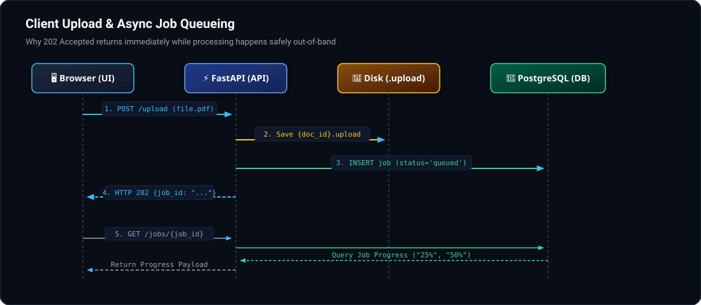
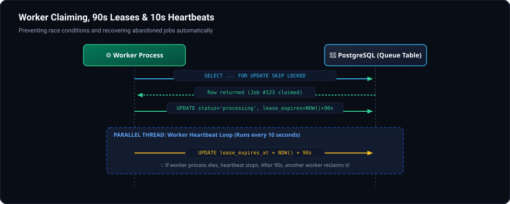
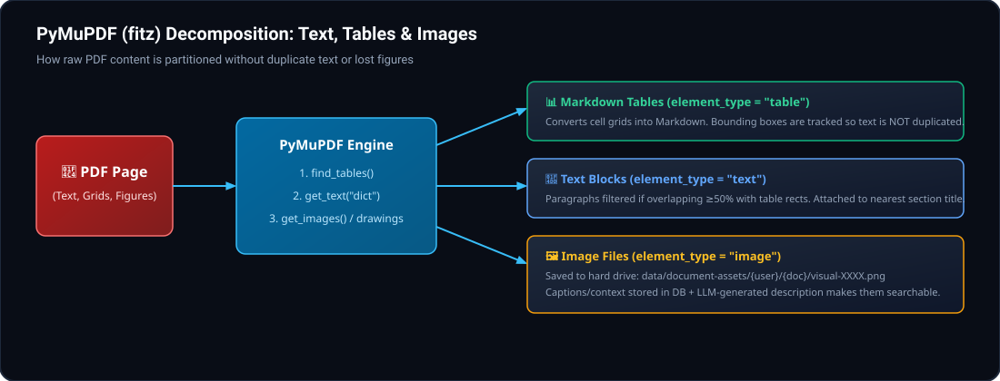
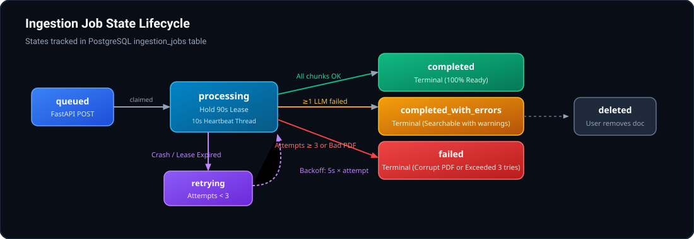

# End-to-End Data & Ingestion Pipeline Guide

A complete, visual reference explaining how documents are uploaded, queued, parsed, sanitized, embedded, stored, and recovered across system failures.

---

## 1. High-Level Architecture Overview


### The Core Flow
1. **The Client (Browser):** Sends a PDF to FastAPI via `POST /upload`.
2. **FastAPI (Web Server):** Writes the file to local disk (`.upload` staging) and creates an `ingestion_jobs` row in PostgreSQL. It immediately returns `202 Accepted` with a `job_id`.
3. **The Worker (Background Process):** Queries PostgreSQL for queued jobs using `FOR UPDATE SKIP LOCKED`, acquires a 90-second lease, and starts processing.
4. **PyMuPDF Parser:** Partitions the PDF into structured text blocks, Markdown tables, and image files.
5. **Presidio + spaCy Sanitizer:** Masks sensitive PII/PHI (patient names, MRNs, phone numbers) while preserving medication/drug names.
6. **Embeddings & Storage:** Text chunks are embedded with `all-MiniLM-L6-v2` (384 dimensions) and saved to PostgreSQL (`pgvector`).
7. **Client Polling:** The UI polls `GET /jobs/{job_id}` every 2.5 seconds until `completed` or `completed_with_errors`.

---

## 2. Ingestion & Workflow Lifecycle


---

## 3. Step-by-Step Interactive Details

### Step 1: Upload & Immediate Staging (FastAPI Web Server)
- **Files:** [`app/main.py`](file:///c:/Users/dyanh/Desktop/job%20soon/amgen/amgen-poc/app/main.py#L122-L146), [`app/services/document_assets.py`](file:///c:/Users/dyanh/Desktop/job%20soon/amgen/amgen-poc/app/services/document_assets.py#L49-L60)



1. The user uploads a file with an optional `Idempotency-Key` header.
2. FastAPI validates file size ($\le 20\text{MB}$) and checks the `%PDF-` magic bytes.
3. Instead of holding large binaries in server RAM or inserting raw blobs into PostgreSQL, it stages the file on disk:
   `data/document-assets/{user_id}/{source_document_id}.upload`
4. It inserts a row into `ingestion_jobs` with `status='queued'` and returns **HTTP 202 Accepted**. The browser never hangs waiting for extraction.

---

### Step 2: Queue Claiming, 90s Leases & 10s Heartbeats (The Worker)
- **Files:** [`app/worker.py`](file:///c:/Users/dyanh/Desktop/job%20soon/amgen/amgen-poc/app/worker.py), [`app/services/ingestion_queue.py`](file:///c:/Users/dyanh/Desktop/job%20soon/amgen/amgen-poc/app/services/ingestion_queue.py)



1. **Atomic Lock:** The worker queries PostgreSQL:
   ```sql
   SELECT * FROM ingestion_jobs 
   WHERE status = 'queued' OR (status = 'processing' AND lease_expires_at <= NOW())
   FOR UPDATE SKIP LOCKED LIMIT 1;
   ```
   `SKIP LOCKED` prevents multiple workers from ever claiming the same row.
2. **The 90-Second Lease:** The worker sets `lease_owner = worker_id` and `lease_expires_at = NOW() + 90s`.
3. **The 10-Second Heartbeat:** A background thread regularly updates `lease_expires_at = NOW() + 90s`.
4. **Crash Detection:** If the worker crashes (e.g., out-of-memory), the heartbeat stops. After 90 seconds, the lease expires and another worker automatically reclaims the job.

---

### Step 3: Parsing & Layout Separation (PyMuPDF / fitz)
- **Files:** [`app/services/document_parser.py`](file:///c:/Users/dyanh/Desktop/job%20soon/amgen/amgen-poc/app/services/document_parser.py), [`app/services/document_assets.py`](file:///c:/Users/dyanh/Desktop/job%20soon/amgen/amgen-poc/app/services/document_assets.py#L17-L47)



1. **Permanent PDF Copy:** The worker copies the file to `data/document-assets/{user_id}/{doc_id}/source.pdf` (for the browser's PDF viewer) and deletes the temporary `.upload` staging file.
2. **Tables (`find_tables()`):** Extracted into clean Markdown tables (`| Col 1 | Col 2 |`). Bounding boxes are tracked so normal text parsers do not index the same numbers twice.
3. **Text Blocks (`get_text("dict")`):** Slices text by paragraph and connects them to section headings. Skips blocks that overlap $\ge 50\%$ with tables.
4. **Images (`get_images()`):** Extracts raster images (filtered by minimum size) and renders complex vector drawings ($\ge 50$ primitives) as high-res PNGs. Images are stored on disk as `visual-XXXX.png`, and a reference link is stored in PostgreSQL.

---

### Step 4: Redaction & Medication Guard (Presidio + spaCy)
- **Files:** [`app/core/sanitize.py`](file:///c:/Users/dyanh/Desktop/job%20soon/amgen/amgen-poc/app/core/sanitize.py)
- **Clinical Recognizers:** Identifies sensitive numbers like `MRN-123456`, `SUBJ-1234`, and `PT-12345`.
- **Standard PII:** Masks `PERSON`, `PHONE_NUMBER`, `EMAIL_ADDRESS`, `SSN`, `LOCATION`, and `IP_ADDRESS`.
- **Medication Guard:** spaCy often mistakes capitalized drug names (e.g., *Enbrel*, *Repatha*) for a `PERSON`. A regular expression checks if the word follows phrases like *"study medication"*, *"medicine"*, or *"therapy"*, leaving drug names unmasked so search remains accurate.

---

### Step 5: Embeddings & PostgreSQL Storage
- **Files:** [`app/models/document_model.py`](file:///c:/Users/dyanh/Desktop/job%20soon/amgen/amgen-poc/app/models/document_model.py), [`app/services/ingestion_worker.py`](file:///c:/Users/dyanh/Desktop/job%20soon/amgen/amgen-poc/app/services/ingestion_worker.py)

Each document is stored as individual passages in PostgreSQL's `documents` table:

```text
Table: documents
├── id: 101                             <-- Integer citation ID [doc:101]
├── source_document_id: "8f2c..."       <-- UUID linking chunks of the same upload
├── raw_content: "Cohort A received..." <-- Redacted text or Markdown table
├── embedding: Vector(384)              <-- pgvector embeddings (all-MiniLM-L6-v2)
├── element_type: "text"|"table"|"image"
├── page_number: 3
├── bbox: [x0, y0, x1, y1]              <-- Coordinates highlighted on the PDF preview
└── visual_assets: ["1/uuid/visual-0.png"]
```

---

## 4. Job State Transitions & Failure Recovery



### Failure Defenses & Guarantees

| Failure Scenario | How the System Recovers |
| :--- | :--- |
| **Worker crashes mid-job** | Heartbeat stops. After 90s, lease expires. Another worker reclaims the row and increments `attempts` (up to 3 tries max). |
| **Resuming without duplicate work** | Before processing each passage, the worker checks PostgreSQL for `(source_document_id, user_id, chunk_index)`. Existing passages are skipped. |
| **"Zombie" worker wakes up** | If Worker A freezes (e.g. GC pause) and Worker B reclaims the job, Worker A's ownership is revoked. When Worker A tries to commit, `lock_owned()` fails and raises `LeaseLost`. |
| **Single chunk LLM failure** | If 19 of 20 passages succeed, the job completes as `completed_with_errors`. The 19 good passages remain searchable in the UI with an amber warning badge. |
| **Corrupted / Invalid PDF** | Raises `ValueError` or HTTP 400. Flagged as permanent; transitions directly to `failed` without wasting retry cycles. |

---

## 5. Storage Summary: Disk vs. Database

```text
Host File System: amgen-poc/data/document-assets/
└── {user_id}/
    └── {source_document_id}/
        ├── source.pdf        <-- Unredacted original PDF for UI viewing/downloading
        ├── visual-0000.png   <-- Extracted high-res diagrams/figures
        └── visual-0001.png

PostgreSQL Database
├── ingestion_jobs            <-- Durable queue: status, progress, lease owner, expiry
├── documents                 <-- Passages: text, markdown tables, pgvector embeddings, bboxes
└── results                   <-- Structured extraction JSON (category, confidence, entities)
```
